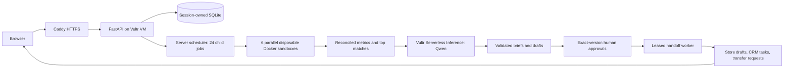

# SalesDesk — Sell more: Your AI sales analyst.

**Every night, it works every lead across every rooftop.** SalesDesk gives dealer-group
leaders a regional roll-up and store managers a ranked morning queue to approve.

[Open SalesDesk](https://salesdesk.149.28.51.139.sslip.io) ·
[Source](https://github.com/Jsjk112344/salesdesk) · [Observed checks and spend](STATUS.md)

## Try it in 60 seconds

1. Open **Group view**: the labelled **Sample dealer group** has 24 rooftops and a saved,
   accepted overnight review.
2. Click **Run tonight’s review now**. Watch actual rooftop jobs and counters on Vultr;
   the full run has its measured wall-clock in [STATUS.md](STATUS.md). You can close the tab.
3. Open **Sandy**, then **Maria G.** She wanted a blue RAV4 Hybrid that sold; SalesDesk
   found a silver alternative with 74 days on lot and drafted a follow-up about her CR-V trade.
4. Choose **Approve all for Sandy**, then download **Follow-ups**, **CRM tasks**, and
   **Transfers**. Enable the nightly review in **Schedule**.

The saved sample opens immediately. A fresh full run is real work and can outlast this
quick tour; store review and approval are also available from the saved sample.


## Architecture



## How Vultr powers it

The existing **proofdesk-web** Ubuntu 24.04 VM in **EWR, New Jersey** runs the API,
SQLite, scheduler and worker subprocesses behind Caddy. It has **2 logical CPUs** and
approximately **4 GiB RAM**. Default rooftop concurrency is **6**, configurable with
`SALESDESK_DEALER_CONCURRENCY` (bounded to 1–12).

The camera-readiness measurement took **140.131 seconds** from Run click through final
public result capture, including final render/screenshot overhead, with six concurrent
rooftop jobs and 25 fresh live Qwen responses. Recorded sample takes reuse accepted Qwen
briefs while executing the Docker analysis live; their own measured runtime is in
[the recording evidence](docs/video/scene-manifest-v2.json). Current and prior-night inputs executed in
48 disposable containers. On the earlier release, observed application memory peaked at **641.59 MiB**; host
available memory stayed above **2,682 MiB**. These are observed checks on this sample,
not capacity or performance promises. [STATUS.md](STATUS.md) records release-specific evidence.

Vultr Serverless Inference runs **`qwen3.8-flash-next`**, JSON output, reasoning disabled.
Both dealer contracts passed live across the full sample. Public runs prefer exact-input
accepted replay, validate it again, and retain the **Qwen 3.8 · Vultr** label with a cached
response tooltip. New inputs can use the same bounded live plans; failures stay visible.
No provider or rule-based output silently substitutes for a failed live brief.

The owner authorized up to $150 of existing hackathon credit for compute and inference.
Dealer inference envelopes are $0.15 / 64 requests; six-request plans share each envelope.
The video measurement uses a separate envelope while preserving the original ledgers.
One complete live run used **$0.0077789** in provider-reported token usage at catalog rates,
under one cent, with compute billed separately.
Existing exhausted ledgers are never reset. Compute billing and credit balance are distinct
from the token-cost estimates in [STATUS.md](STATUS.md). No new VM was provisioned.

## Analyst design

**Match, explain, approve, hand off.** A fixed program reviews every open lead per rooftop,
flags contact gaps of at least 72 hours, sold interests, stale appointments and unanswered
leads, then scores nearby inventory. The top three available units are retained per at-risk
lead. Matching considers make/model/trim/body, year, color, budget, mileage, age and location.
Units aged at least 60 days receive a boost; a same-store match avoids an unnecessary transfer.
Sister stores default to a 250-mile radius. In-transit units retain their status and ETA.

Sandbox artifacts use compact indices to stay within the existing 16 KiB result limit.
Independent controller code reconciles risk flags, top-three scores, distance constraints,
KPI totals, source denominators and carrying costs before expanding them for the UI.
Group totals, distinct aged units matched, rooftop rankings and previous-night deltas come
from accepted child results. Individual failures remain visible.

The **`rooftop_brief`** contract receives validated metrics and curated facts for the top
leads. **`group_brief`** receives the roll-up. Model quantities, vehicle facts and names use
references rendered by code. Draft validators reject unknown leads/stock/references,
unsupported literal quantities, features, promises and sending language. Customer-facing
prose has a restrictive vocabulary. Models receive no raw exports, notes, contact details
or salesperson identities. Qwen drafts cover the top leads; additional drafts are labelled
**Template**. Human edits are labelled **Your edit**.

Approval binds the exact message version, hash and lead/unit snapshot. Edits clear approval;
preparation and every download recheck it. Approved work becomes tasks and drafts for
salespeople, with due date today in Mountain Time, plus manager-review transfer requests.
It never sends a message or executes a vehicle transfer.

**Runs every night at 2:00 AM MT on Vultr** is a server schedule in America/Denver, including
DST handling. Each run stores a snapshot; subsequent deltas use accepted prior results.
Uploaded timestamps remain source facts, while risk and inventory age advance with each
review. Synthetic sample dates move together to preserve the relative story. Public
schedules expire with the anonymous session and remain subject to run quotas.

### Entered floorplan assumption

The default is **$8 per unit per day**, configurable in **Data → Review assumptions** and
shown in **Verification**. Cost to date = days on lot × entered daily rate. It is a flat
illustrative assumption, not measured lending expense. Recoverable gross sums listed price
minus cost over each at-risk lead’s best match; a unit can appear for multiple leads. It
is an estimate from listed figures, not a sales forecast or realized revenue.

## CSV formats

Use three UTF-8 exports. Templates are available on **Data** or at:

- `/api/dealer/templates/rooftops.csv`: id, name, city, lat, lng, brand_mix, manager, salespeople.
- `/api/dealer/templates/inventory.csv`: stock_no, vin, rooftop_id, condition, year, make,
  model, trim, body, color, mileage, list_price, cost, days_on_lot, status, eta, sold_date.
- `/api/dealer/templates/leads.csv`: lead_id, rooftop_id, customer, source, created_at,
  last_contact_at, first_contact_at, last_contact_channel, assigned_salesperson,
  vehicle_of_interest, budget_min, budget_max, trade_in, status, appointment_at, notes.

Headers auto-map common aliases such as Stock #, Dealer ID, Asking Price, Lead Source,
Assigned To and Last Contact. Ambiguous headers, invalid dates/numbers, duplicate identities,
unknown rooftop references and invalid statuses are refused. Each file is capped at **10 MiB
and 50,000 rows**. Primary UI shows accepted/rejected counts; row details are in Verification.
All three files must validate before import. Customer names reduce to first name + last initial.

Inventory statuses: `in_stock`, `in_transit` (ETA required), `sold` (sold_date required).
Lead statuses: `new`, `contacted`, `appointment`, `sold`, `lost`. Dates are ISO-8601;
zone-less dates are interpreted as UTC. Vehicle interest is a stock number or
`year|make|model|trim|color`; trade is `year|make|model|mileage` or blank. Staff and brand lists
use `|`. See the committed [sample and generator](fixtures/dealer-group/README.md).

## Setup

Prerequisites: Python 3.12, uv, Node.js 24+, npm and Docker with Linux cgroup v2/seccomp.

```bash
uv sync --locked
npm --prefix frontend ci
docker pull "$(cat infra/task-image.txt)"
npm --prefix frontend run build
uv run uvicorn backend.app.main:app --host 127.0.0.1 --port 8000 --workers 1
```

Open http://127.0.0.1:8000. A local workspace automatically opens the sample. Private mode
uses explicitly labelled rule-based drafts without credentials. Public mode selects the
Vultr analyst and requires operator plans; there is no silent offline fallback.

Set `PROOFDESK_PUBLIC_DEMO=1`, `SALESDESK_DEALER_LIVE_PLANS` to a directory containing
`r01.json` through `r24.json` and `group.json`, and `VULTR_INFERENCE_API_KEY` outside the
checkout. Plans use the existing authorization schema in [inference.md](docs/inference.md).
Keep the API on one worker; it owns the scheduler. Runtime data are ignored under `.local/`.
Existing `PROOFDESK_*` identifiers remain for compatibility.

Checks:

```bash
uv run ruff check backend scripts
uv run ruff format --check backend scripts
uv run python -m compileall -q backend
uv run python -m unittest discover -s backend/tests -v
PROOFDESK_DOCKER_TESTS=1 uv run python -m unittest discover -s backend/tests -v
npm --prefix frontend run build
python3 scripts/check_repository.py
docker build -t proofdesk-ui-check - < infra/browser-test.Dockerfile
uv run python -m scripts.check_dealer_browser --base-url https://salesdesk.149.28.51.139.sslip.io --screen journey
```

The direct browser check creates actual session work within quotas and uses accepted model
replay when available. The retained legacy UI check is `uv run python -m scripts.check_browser`.
Operator tools for full sandbox acceptance and live contract acceptance are in `scripts/`;
live use requires the existing bounded authorization and must not duplicate ledgers across
concurrently active hosts. [Deployment and rollback](infra/README.md).

## Limits

Summit Auto Group, its stores and its people are fictional, labelled **Sample dealer group**
in records and UI. Makes/models are product names; fictional-format VINs identify no real
vehicles. The sample has 24 stores, 3,000 units, 9,000 open leads and 2,400 historical leads.
It includes planted discoverable patterns, not customer evidence or measured business gains.

Data enters by CSV export. There is no integration with VinSolutions, DealerSocket, CDK,
Reynolds, Salesforce or HubSpot. **Live CRM/DMS connections are next.** New exports are needed
to reflect actual contact, sale or arrival events. No email/SMS is sent; downloads use a
generic task-import format and transfer requests require a person’s review.

Uploaded files are untrusted, session-scoped, size-capped and never committed. Per-rooftop
typed input must also fit the unchanged **1 MiB** sandbox cap; a large concentrated export
can be accepted for import but exceed this analysis limit, producing a visible job failure.
Sandbox limits remain 128 MiB, half CPU, no network/host mounts/credentials, and a 30-second
analysis deadline. Public sessions have six reviews and 72 handoff jobs, global limits,
and a one-day anonymous schedule lifetime. This is a hackathon demo, not production tenancy.

Earlier campaign/prospect code and routes remain unlinked. The proprietary/raw historical
campaign dataset remains ignored and unserved; its separate rights boundary is in
[THIRD_PARTY.md](THIRD_PARTY.md). The [video hand-off](docs/video/RECORDING.md) includes the 3:24 conversational v4 cut, caption files,
scene takes, cards and submission PDF. Record the voiceover, finish the edit and upload
the video and PDF. Official submission remains an owner action; no receipt exists.

## License

Original code and fictional dealer fixtures are [MIT](LICENSE). Dependencies and external
research are attributed in [THIRD_PARTY.md](THIRD_PARTY.md).

The store **Agent trace** opens during a run and reads only that store's real child
events and reconciled outputs. The v2 public recording completed in **124.758 s**,
with 25 accepted Qwen replays and $0 new inference usage. Sandy's 40-draft queue has
three Qwen-authored drafts; the remaining template provenance remains visible.
[Final recording facts](docs/video/recording-facts-v2.json) distinguish this take from
the earlier fresh-inference measurement.
